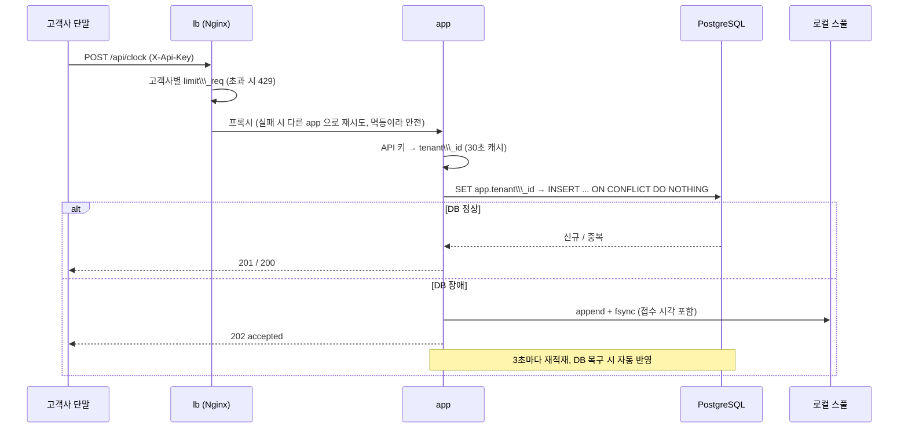

# 최종 과제 리포트 - 기업용 근태 기록 SaaS 인프라

> 인프라 설계 및 구축 (2026-2) · 학번 32222323 · 이름 송원석
> 측정일: 2026-11-23, Solid Cloud(CloudStack 4.19) 실환경. 근거 파일은 `evidence/<시각>-<이름>.txt` 의 `<이름>` 으로 표시한다.
> 저장소: 'https://github.com/wsmaango/att-final'
> 작성 규칙: 각 절 끝의 `\\\[근거]` 칸에 캡처(evidence/)·로그·코드 경로를 반드시 단다. 근거 없는 설명은 "미충족"이다.
> 서비스명은 실제 회사·서비스와 겹치지 않게 정한다. 고객사·직원은 전부 테스트용 더미 데이터다.

\---

## 1\. 기획·요구사항 (8점)

### 1.1 문제와 사용자 (2)

* **문제:** 중소기업은 출퇴근 기록을 엑셀·종이·단독 서버로 관리한다. 서버가 멈추면 그날 출근 기록이 사라지고, 지각·근무시간 산정과 급여에서 분쟁이 생긴다. 기록은 근로시간 관리의 근거라 "몇 건 빠져도 되는" 데이터가 아니다.
* **고객:** 기업(B2B). 고객사가 API 키를 받아 사내 앱·출입 단말·웹에서 호출한다. 실제 사용자는 고객사 직원(출퇴근 체크)과 인사 담당자(현황 조회).
* **핵심 기능:** 출근·퇴근 체크(중복 방지), 당일 현황(출근·미출근·지각), 직원별 월간 기록.
* **SaaS 특성:** 여러 고객사가 한 시스템을 같이 쓴다 → 고객사 간 데이터 분리, 한 고객사의 폭주가 다른 고객사를 막지 않는 것이 요구사항이 된다.

### 1.2 우선순위와 수치 목표 (3)

|순위|항목|이유|수치 목표 (SLO)|
|-|-|-|-|
|1|가용성|출근 시각에 멈추면 기록 유실과 분쟁|업무일 가용성 99.9%(30일 약 43분), **출근 기록 유실 0건 (출근 이벤트 RPO 0)**, app 1대 장애 시 실패 요청 < 0.1%, 그 외 데이터 RPO 15분 / RTO 30분|
|2|성능·확장|08:58\~09:00 에 요청이 몰림|출근 체크 p95 < 500ms, 현황 조회 p95 < 300ms, 피크 250 RPS|
|양보|비용 효율|피크는 하루 몇 분인데 상시 6대|⑦에서 평시 사용률로 야간·주말 축소안 제시|
|부분|보안·규제|근태는 인사 정보|고객사 분리(RLS), 키 해시 저장, TLS 는 적용. 감사 로그 12개월 보존 등 규제 요건은 범위 밖|

**트레이드오프 :** DB 는 data01- 단일로 두고, 대신 출근 이벤트만큼은 유실 0을 앱 스풀로 달성했다. RPO 0, 쓰기 지연 증가·노드 1대 추가인 동기 복제(다 VM 한도와 복잡도를 아꼈다. 측정으로 확인한 	대가와 한계는 이렇다.

* 얻은 것: DB 40초 장애에서 실패 0·유실 0 (스풀이 없으면 실패 48.9%, S1 5.1).
* 잃은 것: DB 장애 중 **조회**(현황·개인 기록)는 캐시가 살아 있는 10초 외에는 실패한다.
* 남은 위험: 스풀이 app 노드 디스크에 있어 **DB 와 그 app 노드가 동시에 죽으면** 접수된 출근이 유실될 수 있다.

### 1.3 규모 가정과 산정 근거 (3)

(가정) 아래 값은 예시다. 근거를 정해 바꾼다.

|항목|값|근거|
|-|-|-|
|고객사|300곳|1년 차 목표 고객사 수(가정)|
|고객사당 직원|평균 200명|중소기업 평균 직원 수(가정)|
|총 직원|60,000명|위 두 값의 곱|
|09:00 직전 2분에 몰리는 비율|40% → 24,000건|출근 9시 고정 기업 비율 가정|
|출근 체크 피크|24,000 ÷ 120초 = **200 RPS**||
|재시도·현황 조회 포함 피크|**250 RPS**|체크 85% · 현황 10% · 기록 5%|
|평시|30 RPS 이하|평시는 피크의 약 1/8 가정|

\[근거] `tests/load/k6-clock-rush.js` 의 stages·비율이 이 표와 같은지 확인.

\---

## 2\. 인프라 설계 (20점)

### 2.1 아키텍처 구성도 (4 - 도식과 구현의 일치)

```mermaid
flowchart TB
  C\\\[고객사 앱·출입 단말<br/>X-Api-Key] -->|HTTPS 443| SIP\\\[(서비스 공인 IP<br/>가상 라우터 LB 규칙 · L4)]
  A\\\[운영자 · VPN 10.8.0.0/24] -->|22xx · 3000 · 9090| MIP\\\[(관리 공인 IP<br/>포트포워딩)]
  subgraph NET\\\[격리 네트워크 192.168.0.0/24]
    SIP --> LB1\\\[lb01 .20<br/>Nginx TLS·L7·고객사별 요청 제한]
    SIP --> LB2\\\[lb02 .21]
    LB1 \\\& LB2 --> APP1\\\[app01 .10<br/>Flask · 스풀]
    LB1 \\\& LB2 --> APP2\\\[app02 .11<br/>Flask · 스풀]
    APP1 \\\& APP2 --> D\\\[(data01 .30<br/>PostgreSQL RLS · Redis)]
    MON\\\[mon01 .40<br/>Prometheus · Grafana · 백업] -.scrape.-> LB1 \\\& LB2 \\\& APP1 \\\& APP2 \\\& D
    MON -.pg\\\_dump 15분.-> D
  end
  MIP -.-> NET
```

|도식의 요소|구현 위치|
|-|-|
|격리 네트워크|`terraform/main.tf` `cloudstack\\\_network.main`|
|L4 분산|`cloudstack\\\_loadbalancer\\\_rule.http/https`|
|L7 분산·TLS·요청 제한|`config/bootstrap/lb.sh`|
|서비스/관리 경로 분리|`cloudstack\\\_ipaddress.service` / `.mgmt`|
|고객사 분리|`app/app.py` SCHEMA (RLS 정책)|
|출근 유실 방지|`app/app.py` `spool\\\_append` / `replay\\\_spool\\\_once`|

\[근거] `A3-console-public-ip.png`(공인 IP 2개, 서비스·관리), `A3-tf-output`(terraform output·state 16개 자원)

### 2.2 워크플로우 도식

**요청 처리 흐름 (출근 체크)**



* **배포 흐름:** 코드 수정 → `git push` → CI(fmt·validate·tflint·checkov 사용자 정책·위반 코드 자체시험·terraform test(mock)·gitleaks) → 작업 VM 에서 `terraform plan` 확인 → `apply` → cloud-init 부트스트랩(2\~3.5분, 미러 혼잡 시 최대 약 20분) → `scripts/smoke-test.sh`(10항목).
운영 중 서버에 급히 반영할 때는 `scripts/live/\\\*.sh` 로 같은 내용을 넣고, 같은 변경을 `config/`·`app/` 에도 커밋해 **다음 재생성에서 같은 결과가 나오는지 destroy → apply 로 확인**했다(3.2 의 2차 재생성).
* **시나리오 대응 흐름:** 경보(Prometheus) → Grafana(요청률·5xx·출근 p95·스풀·고객사별 요청률·401·DB 도달) → 원인 서버 로그(`systemctl status`, nginx `att\\\_access.log`) → 완화(이중화·스풀이 자동으로 버팀, 키 유출이면 `rotate-tenant-key.sh`) → 복구 → `measure.sh`·`verify-no-loss.sh` 로 피해 측정 → 포스트모템 → 코드·Terraform 변경 → 같은 방법으로 재측정. 실제 흐름은 S1·S4 의 타임라인.

### 2.3 이중화와 SPOF 제거 (5)

|계층|구성|장애 시 동작|남은 위험|
|-|-|-|-|
|진입(L4)|가상 라우터 LB 규칙|CloudStack 관리 영역|가상 라우터 자체|
|lb|lb01·lb02|VR LB 가 남은 lb 로. lb01 40초 중지: 실패 0/355, 그동안 lb01 0건·lb02 분당 83→237건 (`5-fail-lb01`, `5-fail-lb01-split2`)|VR LB 는 연결 단위로 나눠 lb 간 부하가 고르지 않음 (S4 의 429 가 lb01 에만)|
|app|app01·app02|Nginx passive 헬스체크(max\_fails=2, fail\_timeout=5s) + `proxy\\\_next\\\_upstream error timeout http\\\_502 http\\\_503 non\\\_idempotent` (API 가 멱등이라 POST 도 재시도). app01 40초 중지: 실패 0/359, 정지 중 app02 가 163건 처리 (`5-fail-app01`)|app 이 503 을 내면 nginx 가 **멀쩡한 app 까지 죽은 것으로 판정** — 스풀을 끈 DB 장애에서 502 140건으로 확인 (S1 5.1). 스풀이 503 자체를 없애 이 연쇄를 막는다|
|data|data01 단일|**SPOF.** 출근 접수는 스풀로 계속(202), 조회는 Redis 캐시(10초)가 있는 동안만. DB 40초 중지: 실패 0/355, 유실 0 (350/350) (`5-fail-db-v3`, `5-fail-db-v3-noloss`)|app·data 동시 장애 시 스풀 유실 가능. 개선안: 스트리밍 복제(data02)|
|관측·백업|mon01 단일|서비스 영향 없음|mon01 이 죽으면 경보와 백업이 같이 멈춤 (수용, 8.3 참고)|

### 2.4 부하 분산·확장·캐시 (5)

* 2단 분산: L4(VR → lb) + L7(Nginx `least\\\_conn` → app)
* 고객사별 요청 제한: `limit\\\_req` 키 = API 키, 100r/s · burst 200 → 한 고객사의 오작동 단말이 다른 고객사를 막지 않음
* 캐시: 현황 조회만 Redis 10초, **키에 tenant\_id 포함** (`t:{tid}:today`), 출근 시 무효화
* **Nginx 공유 캐시(W5 proxy\_cache)는 일부러 쓰지 않음:** 응답이 고객사마다 달라 캐시 키를 잘못 잡으면 다른 고객사 현황이 보인다. 쓰기 위주 서비스라 효과도 작다.
* 수평 확장: `variables.tf` `nodes` 에 app03 추가 → apply. **주의(코드로 확인, 실측은 안 함):** 노드 목록(topology)이 모든 VM 의 user\_data 에 들어가므로 plan 에 전 VM 변경이 뜨고, cloud-init 은 첫 부팅에만 돌기 때문에 lb 의 upstream·ufw·Prometheus 대상은 **자동으로 갱신되지 않는다.** lb·mon 을 `-replace` 하거나 설정을 재배포해야 한다. 개선안: upstream 을 Consul 등 서비스 디스커버리나 설정 관리 도구로 분리.
* 캐시 효과(측정): 부하 3회차 히트율 11.8% (`A1-sli`). 캐시 대상인 현황 조회가 전체의 10% 이고 TTL 10초·고객사별 키라 낮다. 이 서비스의 부하는 읽기가 아니라 쓰기(출근)라서 캐시보다 DB 연결 풀이 효과가 컸다(4.1). `X-Cache` 가 app01 에서 MISS 후 **app02 에서 HIT** — Redis 를 공유해 app 간 캐시가 일관됨, 다른 고객사는 MISS (`A2-cache`)

### 2.5 네트워크와 접근 경로 분리 (3)

|포트|대상|허용 출처|통제 지점|
|-|-|-|-|
|80/443|lb|service\_cidrs|VR 방화벽 + ufw|
|2201\~2206 → 22|각 VM|admin\_cidrs (VPN 10.8.0.0/24, 작업 VM)|VR 방화벽(관리 IP) **+ 서버 ufw** (7단계에서 추가: 내부에서 옆 서버 SSH 차단)|
|5000|app|lb, mon|ufw|
|5432 / 6379|data|app (5432 는 mon 백업 포함)|ufw + bind + pg\_hba / requirepass|
|9100, 9113|전체 / lb|mon|ufw|
|3000, 9090|mon|admin\_cidrs|VR 방화벽(관리 IP) + 서버 ufw (7단계)|
|Egress|전체|tcp 80·443, udp 53·123 만|`cloudstack\\\_egress\\\_firewall`|

\[근거] 외부 스캔 `7-port-scan` (서비스 IP 는 80·443 만, 관리 IP 는 2201·3000·9090 만 OPEN, 5432·6379 closed), ufw `7-ufw-all` → 개선 후 `7-ufw-rest`·`7-ufw-mon01-fix`, **내부 이동 시험** `7-lateral`·`C-lateral`(app01 에서 data01:22·mon01:3000 closed, data01:5432 만 OPEN), 재생성 후 `C-security`

**발견과 조치:** 처음에는 서버 ufw 가 22·3000·9090 을 `Anywhere` 로 열고 VR 방화벽만 믿었다. app 한 대가 뚫리면 내부에서 다른 서버 SSH 로 바로 갈 수 있는 구조였다. VR 포트포워딩이 출발지 IP 를 보존하는 것(`SSH\\\_CLIENT=10.0.10.44`)을 확인한 뒤, 서버 ufw 도 `admin\\\_cidrs` 로 좁혔다(`common.sh`, `mon.sh`, `scripts/live/ufw-admin-only.sh`). 잘못 적용하면 접속이 끊기므로 3분 뒤 자동 원복 타이머를 걸고 한 대씩 적용했다.

### 2.6 대안 비교와 트레이드오프 (3)

|결정|선택|대안|선택 이유|
|-|-|-|-|
|lb 이중화|VR LB 규칙|Keepalived VIP (W3)|포트포워딩이 특정 VM 에 묶여 VIP 를 따라가지 않음 (W3 확인)|
|출근 유실 방지|앱 로컬 스풀 + 재적재|DB 동기 복제 / 메시지 큐|VM 1대로 RPO 0 을 출근 이벤트에 한정해 달성. 한계는 1.2 트레이드오프|
|고객사 분리|공유 DB + RLS|고객사별 DB·스키마|300곳 규모에 운영 부담 최소. RLS 로 앱 버그 시에도 격리|
|캐시|Redis(키에 tenant) 만|Nginx 공유 캐시|고객사 간 노출 위험|
|워크로드|VM|쿠버네티스|계정 한도(vCPU 16)에서 컨트롤 플레인·노드 오버헤드가 크고, 6대 규모에서는 Terraform + cloud-init 으로 충분히 재현 가능(재생성 2\~3.5분). 앱이 여러 개로 늘거나 자동 확장이 필요해지면 재검토|

\---

## 3\. 구축·재현성 (12점)

### 3.1 서비스 동작 (4)

`scripts/smoke-test.sh` 10항목: 301 리다이렉트, readyz 200(DB 연결), 401(키 없음), 출근 201, 재요청 200(멱등), 현황 200, 고객사 2 키 유효(전제), 고객사 1 에서 자기 퇴근 기록 보임(대조군), **다른 고객사에서는 안 보임**, app 2대 응답. 최종 재생성 후 **10/10** (`C-smoke`).

스모크 테스트도 두 번 고쳤다. 부하·공격으로 고객사 2 의 사번 대부분에 자기 기록이 생기자 "고객사 2 에서 빈 목록" 을 기대하던 분리 검사가 오판했다(DB 에서 그 기록이 `tenant\\\_id=2` 임을 직접 확인, `5-fix2-isolation-check`). 부하가 찍지 않는 퇴근(out)을 표식으로 쓰고, 대조군과 키 유효 전제를 넣어 오판·거짓 통과를 모두 막았다.

### 3.2 Terraform 배포와 destroy 후 재생성 (5)

```bash
cd terraform
cp terraform.tfvars.example terraform.tfvars   # 값 채우기 (커밋 금지)
export CLOUDSTACK\\\_API\\\_URL=... CLOUDSTACK\\\_API\\\_KEY=... CLOUDSTACK\\\_SECRET\\\_KEY=...
export TF\\\_VAR\\\_redis\\\_password=... TF\\\_VAR\\\_db\\\_password=...
terraform init \\\&\\\& terraform plan -out plan.out \\\&\\\& terraform apply plan.out
../scripts/smoke-test.sh "$(terraform output -raw service\\\_ip)"
terraform destroy \\\&\\\& terraform apply   # 재생성 → 같은 스모크 테스트 통과
```

|회차|apply 소요|스모크 테스트|근거|
|-|-|-|-|
|1차 (17:27\~18:10)|첫 시도부터 5번째 시도에서 성공. 사이에 고친 오류: VR 생성 전 방화벽 규칙(530), CPU·스토리지 한도, 공인 IP 태그, provider 0.7.0 패닉(0.5.0 고정) — ai-log 참고|8/8 (2단계, 관리 대역 수정 `2-apply-admin\\\*` 후)|`1-apply\\\*`, `2-smoke`|
|destroy 후 재생성 (3단계, 19:48\~)|apply 약 1분 + 부트스트랩 **약 19분** (6대가 같은 Ubuntu 미러에 몰림)|8/8, 부트스트랩 중에는 503|`3-destroy`, `3-apply`, `3-bootstrap`, `3-smoke`|
|destroy 후 재생성 (최종, 22:27\~, 오늘 고친 코드 전부 포함)|apply 약 1분 + 부트스트랩 **2\~3.5분**|**10/10**, 백업·복구 일치, ufw·경보 15개·대시보드 7패널 자동 적용|`C-destroy`, `C-apply`, `C-bootstrap`, `C-smoke`, `C-restore`, `C-security`, `C-monitoring`|

최종 재생성의 목적: 운영 중 `scripts/live/\\\*.sh` 로 직접 반영한 수정(백업 역할, ufw, 앱 코드)이 **제출하는 코드만으로도 처음부터 재현되는지** 확인하는 것. 재생성 후 공인 IP 가 서로 바뀔 수 있어(3단계에서 서비스·관리 IP 가 뒤바뀜) 항상 `terraform output` 기준으로 다시 읽는다.

콘솔에서 만든 자원: **없음** (있다면 이름·사유·대체 스크립트)

### 3.3 fmt·validate 통과와 변수 분리 (3)

`terraform fmt -check -recursive \\\&\\\& terraform validate \\\&\\\& terraform test` → **Success! 3 passed, 0 failed** (`7-tf-check`). variables.tf / outputs.tf / terraform.tfvars.example 분리. 변수 검증: admin\_cidrs 에 0.0.0.0/0 거부·최소 1개, 비밀번호 영숫자 12\~40자, 오퍼링 상한(precondition).

\---

## 4\. 검증·수치 (15점)

### 4.1 부하 테스트와 병목 분석 (5)

`k6 run -e BASE=https://<service\\\_ip> tests/load/k6-clock-rush.js`

|실행|조건|피크 RPS|체크 p95|현황 p95|오류율|병목|근거|
|-|-|-|-|-|-|-|-|
|1|기준선: app 1대, 요청마다 DB 새 접속|약 200 (목표 250 못 감, 7,094건 못 보냄)|**3.58s** ✗|3.61s ✗|0%|**app01 CPU 81%** (gunicorn 1프로세스×8스레드), data01 78%|`4-run1-k6`, `4-run1-cpu`|
|2|app 2대|250 (241건 못 보냄)|1.17s ✗|1.20s ✗|0%|**data01 CPU 99.5%** (app 은 51\~55%로 여유) — 요청마다 접속(TCP + SCRAM 인증 + 프로세스 fork)|`4-run2-k6`, `4-run2-cpu`|
|3|app 2대 + **DB 연결 풀**|250 (전부 처리)|**20.3ms** ✓|**25.4ms** ✓|0%|없음 (동시 VU 최대 9)|`4-run3-k6`|

각 회차 전에 당일 출근 기록을 지웠다(`4-run\\\*-prep`). 출근은 직원당 하루 1번이라 지우지 않으면 2회차부터 대부분 "이미 출근(200)" 이 되어 DB 쓰기가 사라지고 비교가 불공정해진다.

**발견한 병목과 개선:**

1. **서버 지표와 사용자 체감이 달랐다.** 1회차에서 Grafana 의 출근 p95(앱 안쪽)는 약 85ms 였지만 k6(사용자 쪽)는 3.58초였다. 차이는 앱에 들어가기 전 줄 서서 기다린 시간이다. 대기열은 서버 지표에 안 잡히므로 사용자 쪽 측정이 필요하다.
2. **처리 상한 = 동시 처리 수 ÷ 건당 시간.** 8건 ÷ 약 40ms ≈ 200 req/s — 1회차 그래프가 200 에서 평평해진 것과 맞는다.
3. **서버를 2배로 늘린 효과(3배)보다 코드 한 곳(연결 풀)의 효과(58배)가 컸다.** 요청마다 PostgreSQL 에 새로 접속(TCP·SCRAM·fork)하던 것을 풀에서 재사용하도록 바꿨다(`a2632cc`). 고객사 분리는 `set\\\_config(..., true)` 가 트랜잭션 범위라 연결을 재사용해도 안전하고, 이를 시험으로 확인했다.
4. Grafana: `4-grafana-run1/2/3.png`(회차별), `4-grafana-load-runs-all.png`(세 회차 비교).
5. **CPU 가 병목 이동을 보여 준다** (각 구간 최대값, `4-run1-cpu`·`4-run2-cpu`): 1회차는 app01 81%·data01 78% 로 둘 다 높았고, app 을 2대로 늘린 2회차에는 app 이 51\~55% 로 내려간 대신 **data01 이 99.5% 로 포화**됐다. app 을 늘려도 DB 가 접속 처리(인증·fork)에 CPU 를 다 써서 p95 가 1.17초에 머문 이유다. 연결 풀로 접속 자체를 없애자 3회차에서 목표를 달성했다. (3회차 CPU 는 따로 재지 않음.) Grafana 캡처 ①(20:15\~20:50).

### 4.2 장애 주입과 페일오버 측정 (4)

`MODE=clock tests/failover/measure.sh https://<service\\\_ip> 180`

|주입|방법|실패 요청|202(스풀)|체감 중단(ms)|탐지까지|
|-|-|-|-|-|-|
|app01 중지 40초|`systemctl stop att-app`|0 / 359|-|0|개선 전 미탐지 (`InstanceDown` pending 에서 끝남)|
|lb01 중지 40초|`systemctl stop nginx`|0 / 355|-|0|개선 전 미탐지 (규칙 없음)|
|**app01 + lb01 동시 60초** (개선 후)|위 두 개 동시|0 / 477|-|0|`AppBackendsDegraded`·`LbNginxDown` **약 45초**|
|data01 PostgreSQL 40초, **스풀 끔 (기준선)**|`SPOOL\\\_ENABLED=false`|**176 / 360 (48.9%)**, 502 140·503 19|0|**43,738**|-|
|data01 PostgreSQL 40초, 스풀 (1차)|`systemctl stop postgresql`|0 / 214|78|0|미탐지 (`ClockSpoolBacklog` pending), 0.5초 넘은 요청 17%|
|data01 PostgreSQL 40초, 최종 (3차)|같음|0 / 355|있음|0|`DatabaseUnreachable` (2차에서 FIRING 확인), 0.5초 넘은 요청 **0.3%**|

근거: `5-fail-\\\*`, `A5-double-fail`, `B2-fail-db-nospool`, `5-alerts-check`, `5-alerts-after`. 상세 타임라인·원인·조치는 S1.

### 4.3 SLI·SLO 정의와 달성 여부 (3)

|SLI|측정식 (Prometheus)|SLO|측정값|달성|
|-|-|-|-|-|
|성공률|`1 - att:error\\\_ratio:5m`|99.9%|부하 3회차 **100%**, 재생성 이후 134분 전체(부하·장애 주입·공격 포함, 약 18.2만 건) **100%** (5xx 0)|✓|
|출근 체크 지연|`att:clock\\\_p95\\\_seconds:5m`|< 500ms|서버 쪽 17.7ms, 사용자 쪽(k6) 20.3ms (3회차)|✓|
|출근 기록 유실|접수(200·201·202) 건수 vs DB 적재 건수|0건|DB 장애 3회 모두 0 (211/211, 350/350)|✓|
|캐시 히트율|`att:cache\\\_hit\\\_ratio:5m`|참고|11.8% (2.4 참고)|-|

근거: `A1-sli` (Prometheus `@` 시각 지정 쿼리), `5-fail-db-noloss`, `5-fail-db-v3-noloss`.
**주의:** 5xx 가 한 번도 없으면 `att:error\\\_ratio:5m` 의 분자 시계열이 없어 Grafana 에 "No data" 로 나왔다. 오류 0 과 데이터 없음을 구분하려고 `or vector(0)` 을 넣었다(4단계 수정).

### 4.4 백업·복구와 RPO·RTO 측정 (3)

`tests/backup/restore-test.sh` · RPO = 장애 시각 − 최신 덤프 시각, RTO = 탐지부터 정상까지.

|항목|목표|측정|근거|
|-|-|-|-|
|출근 이벤트 RPO|0|**0** (DB 장애 중 접수 350건 전부 적재)|`5-fail-db-v3-noloss`|
|그 외 데이터 RPO|15분|백업 주기 15분, 측정 시점 덤프 나이 7초|`6-restore`|
|복원 시간|-|1초 미만 (덤프 635KB, 직원 6만·출근 2.6만 건), 재생성 후 1초 (313KB)|`6-restore`, `C-restore`|
|RTO (DB 프로세스 장애)|30분|재시작 즉시 정상, 출근 접수는 장애 중에도 계속|S1|
|RTO (DB 데이터 손상 → 백업 복원)|30분|미측정 (복원 1초는 측정, 앱 전환 절차는 미실시)||

**발견: 백업이 처음부터 실패하고 있었다.** 고객사 분리를 위해 테이블에 `FORCE ROW LEVEL SECURITY` 를 걸었더니, 소유자(att)로 돌리는 `pg\\\_dump` 가 RLS 오류로 매번 실패했다. 덤프 파일은 실패해도 8KB 로 15분마다 생겨 겉보기엔 정상이었고, `BackupStale` 경보는 "마지막 성공 시각" 이 오래됐을 때만 보므로 **성공이 한 번도 없으면 평가 자체가 안 됐다.** 복구 리허설을 하다 발견했다(`6-backup-before`).
조치(`9610586`): 읽기 전용 + BYPASSRLS 백업 전용 역할 `att\\\_backup` 을 mon01 IP 에서만 쓰게 했다(앱 계정을 약하게 만들지 않음). 실패한 덤프는 이름을 붙이지 않고 지우며, `pg\\\_restore --list` 로 읽히는 것만 남긴다. `BackupNeverSucceeded`(`absent()`) 경보를 추가했다. 복구 리허설 스크립트도 고객사별 건수를 원본과 비교하도록 다시 썼다.

\---

## 5\. 보안·DevSecOps (10점)

### 5.1 접근 제어·최소 권한·네트워크 분리 (3)

* 인프라: SSH 키 전용·root 금지(`common.sh`), 역할별 ufw, 앱 전용 시스템 계정 `att`(nologin), 시크릿 파일 640 root:att
* 서비스: 고객사 API 키는 SHA-256 해시로만 저장, PostgreSQL RLS(FORCE)로 고객사 간 행 접근 차단
* 고객사 분리 확인: 스모크의 대조군 포함 분리 검사(`C-smoke`), RLS 가 소유자에게도 적용됨(소유자로 `pg\\\_dump` 시 RLS 오류, `6-backup-before`)
* 백업 전용 역할 `att\\\_backup`: `rolbypassrls=t, rolsuper=f, rolcreatedb=f`, pg\_hba 로 mon01 IP·att DB 만 (`6-fix-data01`)
* SSH: 6대 모두 비밀번호·root·keyboard-interactive 로그인 꺼짐, `MaxAuthTries 3`, X11 꺼짐(7단계 추가) (`7-sshd-all`, `C-security`)
* 서버 ufw 를 admin\_cidrs 로 좁혀 **내부 이동 차단** (2.5, `7-lateral`)

### 5.2 Terraform 정적 분석과 조치 (3)

|도구|결과 (2026-11-23 작업 VM, CI 와 같은 옵션)|조치|미조치 사유|
|-|-|-|-|
|checkov 기본 룰|**적용된 룰 0개** - CloudStack 리소스용 기본 룰이 없음|사용자 정의 정책 4개 + terraform test 로 보완 (5.3)|-|
|checkov 사용자 정의 (CKV\_ATT\_1\~4)|통과 15, 실패 0. 위반 코드에서는 4건 모두 실패|-|-|
|tflint (recommended)|문제 없음 (`7-tflint`)|-|-|
|gitleaks (전체 이력)|처음 2건 → 0건 (`7-gitleaks`, `s4-7-gitleaks`)|`terraform test` 더미 비밀번호 오탐 → 그 파일의 `TestOnly…` 값만 예외. 증거 파일 curl 명령 속 공개 데모 키 → 그 값만 예외. 같은 자리의 실제 형식 키는 여전히 탐지됨을 확인|-|

처음 checkov 를 CI 와 다른 옵션으로 돌려 위반 예제 폴더까지 검사해 "실패 4건" 이 나왔다. CI 와 같은 옵션(`--skip-path policies/tests --framework terraform`)으로 다시 돌려 15/15 통과를 확인했다(`7-checkov`, `7-checkov2`).

**발견한 점:** 범용 스캐너는 AWS·Azure·GCP 위주라 CloudStack 코드는 "통과"가 아니라 "검사 대상 없음"이었다. 도구 결과가 0건이라고 안전한 것은 아니므로, 지켜야 할 규칙을 직접 정책으로 만들었다.

### 5.3 Policy as Code / 파이프라인 (2)

`terraform/policies/att\\\_checks.py` (Checkov 사용자 정의) + `terraform/tests/policy.tftest.hcl` (terraform test, mock provider):

|규칙|Checkov 정책|terraform test (CI)|
|-|-|-|
|0.0.0.0/0 에는 80·443 만|CKV\_ATT\_1|서비스 IP 포트·관리 IP 출처 검사|
|VM 필수 태그 project·owner·role|CKV\_ATT\_2|-|
|오퍼링 Small·Medium 상한 (+ variables.tf precondition)|CKV\_ATT\_3|Large 지정 시 실패하는지 확인|
|Egress 는 포트 지정 필수|CKV\_ATT\_4|✓|
|admin\_cidrs 에 0.0.0.0/0 거부|-|거부되는지 확인|
|lb·app 각 2대 이상|-|✓|

CI(GitHub Actions)는 Solid Cloud 에 닿지 않으므로 mock provider 로 plan 을 만들어 검사한다 → API 키를 CI 에 넣지 않아도 된다. 위반 코드(`policies/tests/bad/`)가 실제로 걸리는지도 매번 확인.

**실제 결과 (GitHub Actions, private 저장소):** 첫 실행(#1)은 `secrets` 작업이 실패했다. 작업 VM 에서 0건이던 gitleaks 가 CI 에서는 5건을 잡았는데, 모두 예외로 둔 테스트 더미값과 증거 파일 속 공개 데모 키였다. 액션의 기본 gitleaks 버전이 `.gitleaks.toml` 의 `\\\[\\\[allowlists]]` 형식을 적용하지 못한 것으로 보고, 워크플로에서 버전을 작업 VM 과 같은 8.30.1 로, 설정 파일을 명시적으로 고정했다. 두 번째 실행(#2)에서 terraform·secrets 모두 통과, "No leaks detected". 교훈: **검사 도구의 버전도 코드처럼 고정해야 로컬과 CI 결과가 같다.**
\[근거] `ci-actions-list.png`(#1 실패 → #2 성공), `ci-run2-summary.png`

### 5.4 시크릿 관리와 라이선스 (2)

API 키는 환경변수, 앱 비밀번호는 `TF\\\_VAR\\\_\\\*`, tfstate·tfvars 는 .gitignore, gitleaks(CI, 이력 전체). 오픈소스는 THIRD\_PARTY.md.
**알려진 한계**

* DB·Redis 비밀번호가 user\_data 와 tfstate 에 남는다. 백업 역할 `att\\\_backup` 도 같은 비밀번호를 쓴다. → 개선안: 부팅 시 비밀 저장소(Vault 등)에서 받아오고, 역할별로 비밀번호를 분리한다. tfstate 는 원격 백엔드에 암호화 저장한다.
* **데모 고객사 키가 운영에서 동작했다.** 예측 가능한 키가 저장소(k6·스모크)에 평문으로 있었고, gitleaks 기본 규칙도 무작위성이 낮아 잡지 못했다. S4 에서 실제 유출로 다루고 교체했다(`att\\\_` + 48자리 무작위 키, 전용 탐지 규칙). 다만 전체 재생성하면 앱 초기 데이터가 데모 키를 다시 심는다 → 운영 전에는 고객사 생성 시 무작위 키를 발급하도록 바꿔야 한다.
* 테스트 스크립트는 키를 저장소가 아니라 작업 VM 의 `\\\~/.att-env`(권한 600)에서 읽는다.

\---

## 6\. 시나리오 대응 (20점)

* S1 장애 - 08:57 DB 장애: [scenarios/S1-node-failure.md](../scenarios/S1-node-failure.md)
* S4 보안 사고 - 고객사 API 키 유출: [scenarios/S4-secret-leak.md](../scenarios/S4-secret-leak.md)

|시나리오|목표|실제|전후 수치|변경 커밋|
|-|-|-|-|-|
|S1 DB 장애 40초|유실 0, 접수 계속, 1분 안 탐지|유실 0 (350/350), 실패 0, 탐지 약 30\~45초|실패 48.9%(스풀 없음) → 0, 느린 요청 17% → 0.3%, 탐지 없음 → 있음|`a2632cc`, `a2dd04a`, `3bd358e`|
|S1 app·lb 장애|실패 < 0.1%, 1분 안 탐지|실패 0 (이중 장애 0/477), 탐지 약 45초|탐지 없음 → 약 45초|`a2dd04a`|
|S1 복구 경로|RPO 15분|백업 복구 원본과 일치|백업된 출근 0건 → 전부|`9610586`|
|S4 키 유출|15분 안 탐지·차단·영향 0·범위 식별|다른 고객사 실패 0%, 옛 키 9.1초 차단, 위조 의심 8,702건|탐지 없음 → 1분 44초(401)·2분 59초(폭주), gitleaks 놓침 → 탐지|`3ea6683`, `1d5947d`|

## 7\. AI 활용 (8점)

요약만 쓰고 상세는 [ai-log.md](../ai-log.md). 사전 지침: [CLAUDE.md](../CLAUDE.md).

## 8\. 창의·상용화 (7점)

### 8.1 문제 선택과 차별점 (2)

일반 근태 서비스는 "서버가 살아 있을 때" 만 기록된다. 이 설계는 DB 장애 중에도 출근을 접수(202)하고 **DB 적재 시각이 아니라 접수 시각**으로 기록해, 근태 분쟁의 원인인 누락과 지각 오판을 없애는 데 초점을 둔다. 측정으로 보인 차이: 같은 40초 DB 장애에서 스풀이 없으면 출근 요청의 48.9% 가 실패하고 장애가 lb 까지 번졌지만(502), 이 설계에서는 실패 0·유실 0 이었다(S1).
두 번째 차별점은 **멀티테넌트 격리를 DB 수준(RLS FORCE)과 운영 신호 수준(고객사별 요청률·호출 제한) 양쪽에서** 한 것이다. 한 고객사 키가 유출돼 폭주해도 다른 고객사 실패율은 0% 였다(S4).

### 8.2 비용 구조 (3)

Solid Cloud 는 학내 무료이므로 **동급 공용 클라우드 가격으로 환산**한다. 단가는 조사 날짜·출처를 적는다.

|자원|수량|단가(월, 출처·날짜)|월 비용|
|-|-|-|-|
|2vCPU VM (NCP Standard-g3, 2vCPU·8GB)|6|82,240원 (ncloud.com 리전별 요금표, VAT 별도, 2026-11-23 조회)|493,440원|
|(참고) 메모리 4GB 급 (High CPU-g3 2vCPU·4GB)|6|66,240원 (2차 출처 wikidocs 정리, 공식 확인 필요)|397,440원|
|공인 IP|2|시간당 5.6원 (출처 NCP 공식 요금표)|8,064원|
|블록 스토리지|6 × 20GB|10GB당 시간당 0.8원 (출처 NCP 공식 요금표)|69,120원|
|합계 (VM 기준)|||**약 49만 원** (+ IP·스토리지)|
|**고객사당 비용**|÷ 300곳||약 1,645원|
|**직원 1명당 비용**|÷ 60,000명||약 8.2원|

해석: 직원 1명당 월 1,000원 요금제라면 인프라 비용은 매출의 1% 미만이다. 손익분기는 인프라만 보면 직원 약 500명(≈ 49만 원 ÷ 1,000원), 고객사 3곳 수준이다. 실제 비용의 대부분은 인프라가 아니라 운영 인력·지원이다.
축소안: 피크는 하루 몇 분(08:58\~09:00)이고 부하 3회차에서 app 2대가 250 req/s 를 p95 20ms 로 처리했다. 평시(30 req/s 이하)에는 app 1대로 충분하므로 야간·주말에 app02·lb02 를 정지하면 약 1/3 절감 가능하다. 다만 그동안은 이중화가 없어진다 — 가용성 1순위와 충돌하므로 출근 시간대(07\~10시)에는 반드시 2대를 유지한다.

요금제 가정(예: 직원 1명당 월 ○원)과 비교해 손익분기 고객사 수를 계산. 평시 사용률(Grafana CPU 평균)로 야간·주말 축소안.

### 8.3 규모가 커질 때 바뀌는 점과 위험 (2)

10배(3,000곳·60만 명)가 되면 09:00 쓰기가 약 2,000\~2,500 RPS 가 된다. 이번 측정과 발견에서 직접 이어지는 변화와 위험은 이렇다.

* **단일 PostgreSQL 쓰기 한계:** 연결 풀로 250 RPS 는 여유가 있었지만 10배는 미측정. 대응: 출근 접수를 큐로 받아 비동기 적재(지금의 스풀을 정식 큐로), 고객사 단위 샤딩, 대형 고객사 전용 격리.
* **고객사별 호출 제한이 느슨해진다:** 제한을 lb 마다 따로 세므로 lb 를 늘리면 고객사당 상한이 lb 수만큼 커진다(S4 에서 429 가 lb01 에만 난 것으로 확인). 대응: Redis 공유 카운터 기반 제한.
* **노드 추가가 전체 재배포가 된다:** 노드 목록이 모든 VM 의 user\_data 에 들어가 있어 app 1대를 늘려도 lb·mon 설정을 다시 배포해야 한다(2.4). 대응: 서비스 디스커버리, 설정 관리 분리.
* **관측·백업 단일점:** mon01 이 죽으면 경보와 백업이 같이 멈춘다. 대응: 백업을 다른 노드·오브젝트 스토리지로 분리, 경보 이중화.
* **위험:** 대형 고객사 한 곳의 폭주·장애가 공유 DB 를 통해 전체로 번질 수 있다 → 고객사별 호출량 경보(S4 에서 추가)를 등급별 한도와 연결한다.

## 9\. 회고

이번 프로젝트를 하면서 가장 크게 배운 것은 프로젝트를 실행할 때 원하는 결과가 나왔더라도 다시 한번 꼭 확인해야 한다는 점을 깨달았다. 실제 있었던 사건으로 백업 덤프 파일이 15분마다 생겼지만 전부 8KB짜리 깨진 파일이었고, 출근 기록은 0건 백업되어 있었다. 복구 리허설을 해 보고서야 깨달았다. DB장애 때 유실은 0이었지만, 출근 요청이 17%가 0.5초 넘게 걸리고 있었다. 기능시험만으로는 안 보였다. 5xx 0건이 Grafana에서는 "No data"로 보였다.
확실히 배운 점은 결과 파일이나 성공 여부가 아니라 실제로 복원하고, 분포를 보고, 경보 이력까지 확인해야 한다는 것이다. AI를 쓰면서 이런 점들을 잡아 줄수는 있지만 결국 내가 직접 알아차리지 못한다면 전부 놓쳤을 거라 생각하여 AI가 완전히 완벽하지는 않다는 것을 느꼈다.

## 부록

* A. 전체 `terraform plan` 요약
* B. 캡처 목록 (evidence/ 파일명 ↔ 본문 위치)

