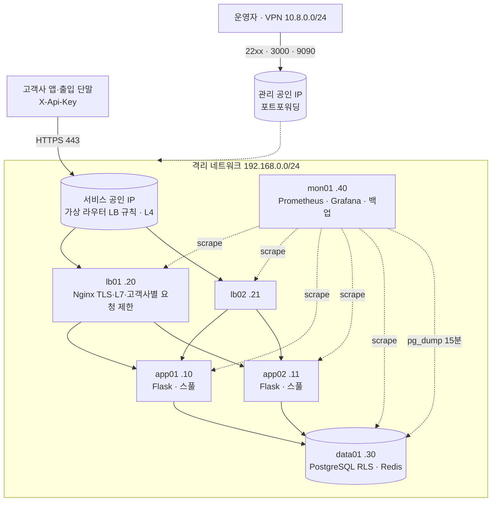

# 최종 과제 리포트 - 기업용 근태 기록 SaaS 인프라

> 인프라 설계 및 구축 (2026-2) · 학번 `TODO` · 이름 `TODO`
> 저장소: `TODO 공개 GitHub URL (가산 2점)`
>
> 작성 규칙: 각 절 끝의 `[근거]` 칸에 캡처(evidence/)·로그·코드 경로를 반드시 단다. 근거 없는 설명은 "미충족"이다.
> `TODO` 와 `(가정)` 표시는 실제 측정·결정 후 바꾼다. 제출 전 이 문서에서 `TODO` 를 검색해 0건으로 만든다.
> 서비스명은 실제 회사·서비스와 겹치지 않게 정한다. 고객사·직원은 전부 테스트용 더미 데이터다.

---

## 1. 기획·요구사항 (8점)

### 1.1 문제와 사용자 (2)
- **문제:** 중소기업은 출퇴근 기록을 엑셀·종이·단독 서버로 관리한다. 서버가 멈추면 그날 출근 기록이 사라지고, 지각·근무시간 산정과 급여에서 분쟁이 생긴다. 기록은 근로시간 관리의 근거라 "몇 건 빠져도 되는" 데이터가 아니다.
- **고객:** 기업(B2B). 고객사가 API 키를 받아 사내 앱·출입 단말·웹에서 호출한다. 실제 사용자는 고객사 직원(출퇴근 체크)과 인사 담당자(현황 조회).
- **핵심 기능:** 출근·퇴근 체크(중복 방지), 당일 현황(출근·미출근·지각), 직원별 월간 기록.
- **SaaS 특성:** 여러 고객사가 한 시스템을 같이 쓴다 → 고객사 간 데이터 분리, 한 고객사의 폭주가 다른 고객사를 막지 않는 것이 요구사항이 된다.

### 1.2 우선순위와 수치 목표 (3)

| 순위 | 항목 | 이유 | 수치 목표 (SLO) |
|---|---|---|---|
| 1 | 가용성 | 출근 시각에 멈추면 기록 유실과 분쟁 | 업무일 가용성 99.9%(30일 약 43분), **출근 기록 유실 0건 (출근 이벤트 RPO 0)**, app 1대 장애 시 실패 요청 < 0.1%, 그 외 데이터 RPO 15분 / RTO 30분 |
| 2 | 성능·확장 | 08:58~09:00 에 요청이 몰림 | 출근 체크 p95 < 500ms, 현황 조회 p95 < 300ms, 피크 250 RPS |
| 양보 | 비용 효율 | 피크는 하루 몇 분인데 상시 6대 | ⑦에서 평시 사용률로 야간·주말 축소안 제시 |
| 부분 | 보안·규제 | 근태는 인사 정보 | 고객사 분리(RLS), 키 해시 저장, TLS 는 적용. 감사 로그 12개월 보존 등 규제 요건은 범위 밖 |

**트레이드오프:** `TODO` 본인 말로. 예: DB 는 단일(data01)로 두고, 대신 "출근 이벤트만큼은 유실 0" 을 앱 스풀로 달성했다. 동기 복제(RPO 0, 쓰기 지연 증가·노드 1대 추가)보다 VM 한도와 복잡도를 아꼈지만, 스풀이 app 노드 디스크에 있어 **DB 와 app 노드가 동시에 죽으면** 접수된 출근이 유실될 수 있다.

### 1.3 규모 가정과 산정 근거 (3)
(가정) 아래 값은 예시다. 근거를 정해 바꾼다.

| 항목 | 값 | 근거 |
|---|---|---|
| 고객사 | 300곳 | `TODO` (1년 차 목표 등) |
| 고객사당 직원 | 평균 200명 | `TODO` |
| 총 직원 | 60,000명 | 위 두 값의 곱 |
| 09:00 직전 2분에 몰리는 비율 | 40% → 24,000건 | `TODO` (출근 시각 분포 가정) |
| 출근 체크 피크 | 24,000 ÷ 120초 = **200 RPS** | |
| 재시도·현황 조회 포함 피크 | **250 RPS** | 체크 85% · 현황 10% · 기록 5% |
| 평시 | 30 RPS 이하 | `TODO` |

[근거] `tests/load/k6-clock-rush.js` 의 stages·비율이 이 표와 같은지 확인.

---

## 2. 인프라 설계 (20점)

### 2.1 아키텍처 구성도 (4 - 도식과 구현의 일치)



| 도식의 요소 | 구현 위치 |
|---|---|
| 격리 네트워크 | `terraform/main.tf` `cloudstack_network.main` |
| L4 분산 | `cloudstack_loadbalancer_rule.http/https` |
| L7 분산·TLS·요청 제한 | `config/bootstrap/lb.sh` |
| 서비스/관리 경로 분리 | `cloudstack_ipaddress.service` / `.mgmt` |
| 고객사 분리 | `app/app.py` SCHEMA (RLS 정책) |
| 출근 유실 방지 | `app/app.py` `spool_append` / `replay_spool_once` |

[근거] 콘솔 자원 목록, `terraform output` 캡처

### 2.2 워크플로우 도식
**요청 처리 흐름 (출근 체크)**

- 배포 흐름: `TODO` (git push → CI(fmt·validate·tflint·checkov·정책 자체시험·gitleaks) → 본인 PC 에서 plan 확인 → apply → smoke-test)
- 시나리오 대응 흐름: `TODO` (알림 → 대시보드·로그 확인 → 완화 → 복구 → 포스트모템 → Terraform 변경)

### 2.3 이중화와 SPOF 제거 (5)

| 계층 | 구성 | 장애 시 동작 | 남은 위험 |
|---|---|---|---|
| 진입(L4) | 가상 라우터 LB 규칙 | CloudStack 관리 영역 | 가상 라우터 자체 |
| lb | lb01·lb02 | VR LB 가 남은 lb 로 | `TODO` 측정값 |
| app | app01·app02 | Nginx passive 헬스체크(max_fails=2, 5s) + `proxy_next_upstream ... non_idempotent` (API 가 멱등이라 POST 도 재시도) | `TODO` |
| data | data01 단일 | **SPOF.** 출근 접수는 스풀로 계속(202), 조회는 Redis 캐시가 있는 동안만 | app·data 동시 장애 시 스풀 유실 가능. 개선안: 스트리밍 복제(data02) |
| 관측 | mon01 단일 | 서비스 영향 없음 | 수용 |

### 2.4 부하 분산·확장·캐시 (5)
- 2단 분산: L4(VR → lb) + L7(Nginx `least_conn` → app)
- 고객사별 요청 제한: `limit_req` 키 = API 키, 100r/s · burst 200 → 한 고객사의 오작동 단말이 다른 고객사를 막지 않음
- 캐시: 현황 조회만 Redis 10초, **키에 tenant_id 포함** (`t:{tid}:today`), 출근 시 무효화
- **Nginx 공유 캐시(W5 proxy_cache)는 일부러 쓰지 않음:** 응답이 고객사마다 달라 캐시 키를 잘못 잡으면 다른 고객사 현황이 보인다. 쓰기 위주 서비스라 효과도 작다.
- 수평 확장: `variables.tf` `nodes` 에 app03 추가 → apply (lb 의 upstream 은 cloud-init 에서 생성되므로 lb 재생성 필요 여부 `TODO` 확인)

### 2.5 네트워크와 접근 경로 분리 (3)

| 포트 | 대상 | 허용 출처 | 통제 지점 |
|---|---|---|---|
| 80/443 | lb | service_cidrs | VR 방화벽 + ufw |
| 2201~2206 → 22 | 각 VM | VPN 대역만 | VR 방화벽(관리 IP) |
| 5000 | app | lb, mon | ufw |
| 5432 / 6379 | data | app (5432 는 mon 백업 포함) | ufw + bind + pg_hba / requirepass |
| 9100, 9113 | 전체 / lb | mon | ufw |
| 3000, 9090 | mon | VPN 대역만 | VR 방화벽(관리 IP) |
| Egress | 전체 | tcp 80·443, udp 53·123 만 | `cloudstack_egress_firewall` |

[근거] `nc -vz` 외부 스캔(W7 A1 방식), `sudo ufw status numbered`

### 2.6 대안 비교와 트레이드오프 (3)

| 결정 | 선택 | 대안 | 선택 이유 |
|---|---|---|---|
| lb 이중화 | VR LB 규칙 | Keepalived VIP (W3) | 포트포워딩이 특정 VM 에 묶여 VIP 를 따라가지 않음 (W3 확인) |
| 출근 유실 방지 | 앱 로컬 스풀 + 재적재 | DB 동기 복제 / 메시지 큐 | VM 1대로 RPO 0 을 출근 이벤트에 한정해 달성. 한계는 1.2 트레이드오프 |
| 고객사 분리 | 공유 DB + RLS | 고객사별 DB·스키마 | 300곳 규모에 운영 부담 최소. RLS 로 앱 버그 시에도 격리 |
| 캐시 | Redis(키에 tenant) 만 | Nginx 공유 캐시 | 고객사 간 노출 위험 |
| 워크로드 | VM | 쿠버네티스 | `TODO` |

---

## 3. 구축·재현성 (12점)

### 3.1 서비스 동작 (4)
`scripts/smoke-test.sh` 결과: 301 리다이렉트, 401(키 없음), 출근 201, 재요청 200(멱등), 현황 200, 다른 고객사에서 기록 안 보임, app 2대 응답. `TODO` 캡처

### 3.2 Terraform 배포와 destroy 후 재생성 (5)
```bash
cd terraform
cp terraform.tfvars.example terraform.tfvars   # 값 채우기 (커밋 금지)
export CLOUDSTACK_API_URL=... CLOUDSTACK_API_KEY=... CLOUDSTACK_SECRET_KEY=...
export TF_VAR_redis_password=... TF_VAR_db_password=...
terraform init && terraform plan -out plan.out && terraform apply plan.out
../scripts/smoke-test.sh "$(terraform output -raw service_ip)"
terraform destroy && terraform apply   # 재생성 → 같은 스모크 테스트 통과
```
| 회차 | apply 소요 | 스모크 테스트 | 근거 |
|---|---|---|---|
| 1차 | `TODO` | `TODO` | |
| destroy 후 재생성 | `TODO` | `TODO` | |

콘솔에서 만든 자원: **없음** (있다면 이름·사유·대체 스크립트)

### 3.3 fmt·validate 통과와 변수 분리 (3)
`TODO` 출력 캡처. variables.tf / outputs.tf / terraform.tfvars.example 분리 완료.

---

## 4. 검증·수치 (15점)

### 4.1 부하 테스트와 병목 분석 (5)
`k6 run -e BASE=https://<service_ip> tests/load/k6-clock-rush.js`

| 실행 | 조건 | 피크 RPS | 체크 p95 | 현황 p95 | 오류율 | 병목 | 근거 |
|---|---|---|---|---|---|---|---|
| 1 | 기준선 (app 1대, 캐시 끔) | | | | | | |
| 2 | app 2대 | | | | | | |
| 3 | app 2대 + 개선 `TODO` (예: DB 연결 풀, 인덱스) | | | | | | |

병목 찾는 법: k6 중 Grafana 에서 app CPU, data01 CPU·IO, lb 활성 연결, 429 수를 같이 본다. 쓰기 위주라 DB 가 먼저 막힐 가능성이 높다. `TODO` 발견한 병목과 개선 전후.

### 4.2 장애 주입과 페일오버 측정 (4)
`MODE=clock tests/failover/measure.sh https://<service_ip> 180`

| 주입 | 방법 | 실패 요청 | 202(스풀) | 체감 중단(ms) | 탐지까지 |
|---|---|---|---|---|---|
| app01 중지 | `systemctl stop att-app` | | - | | |
| lb01 중지 | `systemctl stop nginx` | | - | | |
| data01 PostgreSQL 중지 | `systemctl stop postgresql` | | | | `ClockSpoolBacklog` |

### 4.3 SLI·SLO 정의와 달성 여부 (3)
| SLI | 측정식 (Prometheus) | SLO | 측정값 | 달성 |
|---|---|---|---|---|
| 성공률 | `1 - att:error_ratio:5m` | 99.9% | | |
| 출근 체크 지연 | `att:clock_p95_seconds:5m` | < 500ms | | |
| 출근 기록 유실 | 접수(200·201·202) 건수 vs DB 적재 건수 | 0건 | | |
| 캐시 히트율 | `att:cache_hit_ratio:5m` | 참고 | | |

### 4.4 백업·복구와 RPO·RTO 측정 (3)
`tests/backup/restore-test.sh` · RPO = 장애 시각 − 최신 덤프 시각, RTO = 탐지부터 정상까지.
| 항목 | 목표 | 측정 | 근거 |
|---|---|---|---|
| 출근 이벤트 RPO | 0 | | 스풀 재적재 전후 건수 |
| 그 외 데이터 RPO | 15분 | | |
| RTO (DB 복구) | 30분 | | |

---

## 5. 보안·DevSecOps (10점)

### 5.1 접근 제어·최소 권한·네트워크 분리 (3)
- 인프라: SSH 키 전용·root 금지(`common.sh`), 역할별 ufw, 앱 전용 시스템 계정 `att`(nologin), 시크릿 파일 640 root:att
- 서비스: 고객사 API 키는 SHA-256 해시로만 저장, PostgreSQL RLS(FORCE)로 고객사 간 행 접근 차단
- `TODO` 캡처: 다른 고객사 키로 조회 시 빈 결과, RLS 설정 없이 DB 직접 조회 시 0건

### 5.2 Terraform 정적 분석과 조치 (3)
| 도구 | 결과 (초안 코드 기준, `TODO` 본인 환경 결과로 교체) | 조치 | 미조치 사유 |
|---|---|---|---|
| checkov 기본 룰 | **적용된 룰 0개** - CloudStack 리소스용 기본 룰이 없음 | 사용자 정의 정책 4개 + terraform test 로 보완 (5.3) | - |
| checkov 사용자 정의 (CKV_ATT_1~4) | 통과 15, 실패 0. 위반 코드에서는 4건 모두 실패 | - | - |
| tflint (recommended) | `TODO` | | |

**발견한 점:** 범용 스캐너는 AWS·Azure·GCP 위주라 CloudStack 코드는 "통과"가 아니라 "검사 대상 없음"이었다. 도구 결과가 0건이라고 안전한 것은 아니므로, 지켜야 할 규칙을 직접 정책으로 만들었다.

### 5.3 Policy as Code / 파이프라인 (2)
`terraform/policies/att_checks.py` (Checkov 사용자 정의) + `terraform/tests/policy.tftest.hcl` (terraform test, mock provider):

| 규칙 | Checkov 정책 | terraform test (CI) |
|---|---|---|
| 0.0.0.0/0 에는 80·443 만 | CKV_ATT_1 | 서비스 IP 포트·관리 IP 출처 검사 |
| VM 필수 태그 project·owner·role | CKV_ATT_2 | - |
| 오퍼링 Small·Medium 상한 (+ variables.tf precondition) | CKV_ATT_3 | Large 지정 시 실패하는지 확인 |
| Egress 는 포트 지정 필수 | CKV_ATT_4 | ✓ |
| admin_cidrs 에 0.0.0.0/0 거부 | - | 거부되는지 확인 |
| lb·app 각 2대 이상 | - | ✓ |

CI(GitHub Actions)는 Solid Cloud 에 닿지 않으므로 mock provider 로 plan 을 만들어 검사한다 → API 키를 CI 에 넣지 않아도 된다. 위반 코드(`policies/tests/bad/`)가 실제로 걸리는지도 매번 확인. `TODO` Actions 캡처.

### 5.4 시크릿 관리와 라이선스 (2)
API 키는 환경변수, 앱 비밀번호는 `TF_VAR_*`, tfstate·tfvars 는 .gitignore, gitleaks(CI, 이력 전체). 오픈소스는 THIRD_PARTY.md.
**알려진 한계:** DB·Redis 비밀번호가 user_data 와 tfstate 에 남는다 → 개선안 `TODO`. 데모 고객사 키(`demo-key-tenant-*`)는 배포 후 `scripts/rotate-tenant-key.sh` 로 교체한다.

---

## 6. 시나리오 대응 (20점)
- S1 장애 - 08:57 DB 장애: [scenarios/S1-node-failure.md](../scenarios/S1-node-failure.md)
- S4 보안 사고 - 고객사 API 키 유출: [scenarios/S4-secret-leak.md](../scenarios/S4-secret-leak.md)

요약 표: 목표 / 실제 소요 / 전후 수치 / Terraform·코드 변경 커밋 `TODO`

## 7. AI 활용 (8점)
요약만 쓰고 상세는 [ai-log.md](../ai-log.md). 사전 지침: [CLAUDE.md](../CLAUDE.md).

## 8. 창의·상용화 (7점)

### 8.1 문제 선택과 차별점 (2)
`TODO` 예: 일반 근태 서비스는 "서버가 살아 있을 때"만 기록된다. 이 설계는 DB 장애 중에도 출근을 접수하고 접수 시각으로 기록해, 근태 분쟁의 원인인 누락을 없애는 데 초점을 둔다.

### 8.2 비용 구조 (3)
Solid Cloud 는 학내 무료이므로 **동급 공용 클라우드 가격으로 환산**한다. 단가는 조사 날짜·출처를 적는다.
| 자원 | 수량 | 단가(월, 출처·날짜) | 월 비용 |
|---|---|---|---|
| 2vCPU/4GB VM | 6 | `TODO` | |
| 공인 IP | 2 | `TODO` | |
| 합계 | | | |
| **고객사당 비용** | 합계 ÷ 300곳 | | |
| **직원 1명당 비용** | 합계 ÷ 60,000명 | | |

요금제 가정(예: 직원 1명당 월 ○원)과 비교해 손익분기 고객사 수를 계산. 평시 사용률(Grafana CPU 평균)로 야간·주말 축소안.

### 8.3 규모가 커질 때 바뀌는 점과 위험 (2)
`TODO` 예: 10배(3,000곳·60만 명) → 09:00 쓰기 2,000 RPS 로 단일 PostgreSQL 쓰기 한계. 대응: 출근 접수를 큐로 받아 비동기 적재, 고객사 단위 샤딩, 대형 고객사 전용 격리. 위험: 대형 고객사 한 곳의 장애가 전체로 번짐.

## 9. 회고
`TODO`

## 부록
- A. 전체 `terraform plan` 요약
- B. 캡처 목록 (evidence/ 파일명 ↔ 본문 위치)
